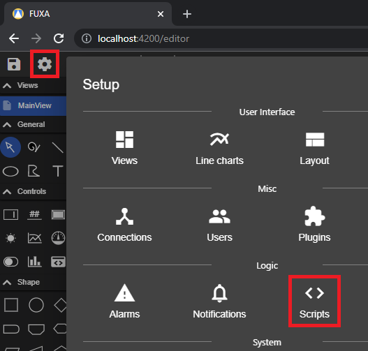
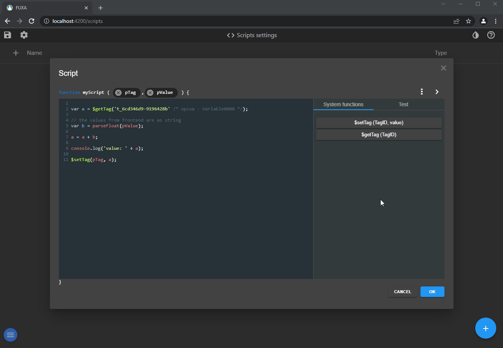

To configure scripts going to **Scripts** in editor.



Add a new script (a script is a javascript function), configure the function name and parameters, there are 2 type of parameters:
 - Tag ID
 - Value, number or string

Then you write your logic into the function. There are system call that you can use:
 - $setTag, to set value of Tag
 - $getTag, to get current Tag value

## Supported JavaScript system functions

AI-generated scripts are restricted to the functions below. A function not listed here
is not a FUXA API and must not be generated or used.

Available in server scripts:

- `$getTag(tagId)`, `$setTag(tagId, value)`, `$getTagId(tagName, deviceName?)`
- `$getTagDaqSettings(tagId)`, `$setTagDaqSettings(tagId, settings)`
- `$setView(viewName, force?)`, `$setViewBackground(cssColor)`
- `$setControlBackground(controlNameOrId, cssColor)`
- `$enableDevice(deviceName, enabled)`, `$getDevice(deviceName)`
- `$getDeviceProperty(deviceName)`, `$setDeviceProperty(deviceName, property)`
- `$getHistoricalTags(tagIds, fromTimestamp, toTimestamp)`
- `$sendMessage(to, subject, message)`
- `$getAlarms()`, `$getAlarmsHistory(fromDate, toDate)`, `$ackAlarm(alarmName, types?)`

Additional functions available only in client scripts:

- `$openCard(viewName, options?)`
- `$setAdapterToDevice(adapterName, deviceName)`, `$resolveAdapterTagId(tagId)`
- `$invokeObject(controlName, methodName, ...params)`, `$getObject(controlName)`
- `$runServerScript(scriptName, ...params)`

AI output is validated against the appropriate server/client whitelist. Unsupported
`$function()` calls are rejected before they can replace the editor source.


You can test the script, to verify it makes sense to use the console.log method.



From the GUI you can configure in **Events** the call of script.


If you use intervals in a script it's important you handle them correctly. For example if you have setInterval in a script and run the test multiple times this will create a new interval each time calling the same piece of code and you will have to restart Fuxa to clear it. One method to handle this is assign an ID to the interval and do a simple check if it exist. 

```
if (typeof globalThis.myTimer === 'undefined') globalThis.myTimer = null;

if (!globalThis.myTimer) globalThis.myTimer = setInterval(myTimerFunction, 1000);

async function myTimerFunction() {
  //myTimer code here every 1 sec
}
```
